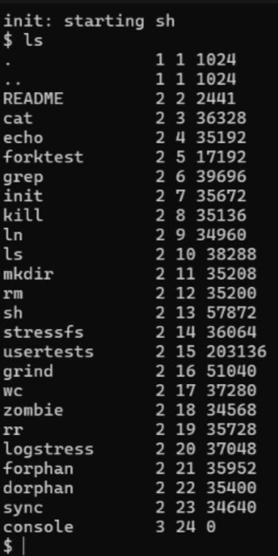
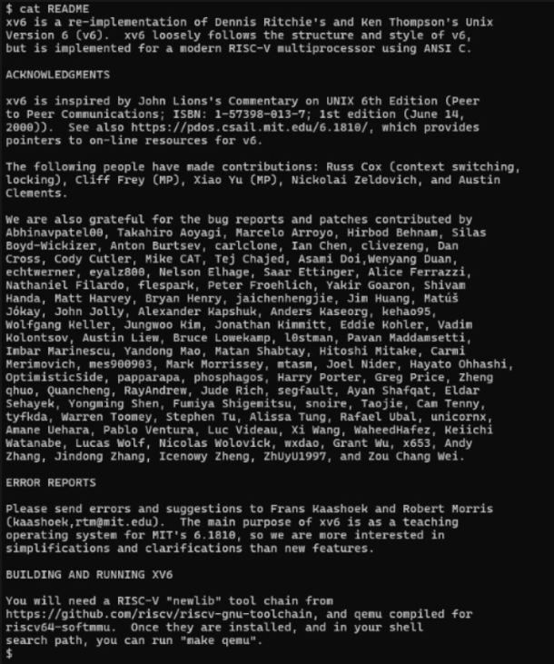
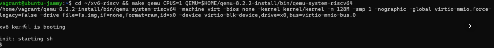
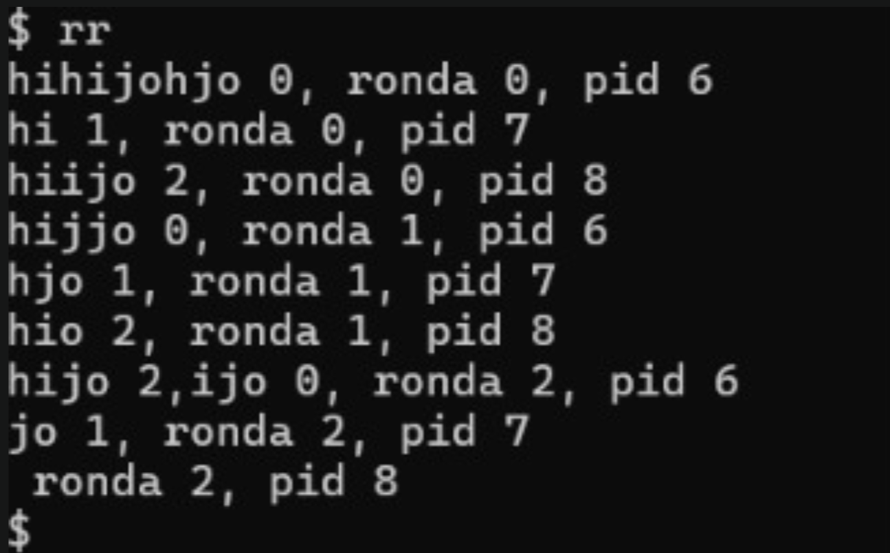

# Exploración de la planificación de procesos en XV6

**Curso:** Sistemas Operativos
**Integrantes:**
- Nicolás Revelo
- Juan Sebastian Sanclemente

**Repositorio (fork):** https://github.com/juansebastiansanclemente-svg/xv6-riscv

---

## 1. Repositorio, entorno y herramientas

### 1.1 Fork y revisión de partida

| Dato | Valor |
|---|---|
| Fork | https://github.com/juansebastiansanclemente-svg/xv6-riscv |
| Sistema Linux | Ubuntu 22.04.5 LTS (jammy), en una máquina virtual con Vagrant/VirtualBox |
| Commit de partida | `fa2ddcb7ca87a77af579380a6eafd5aff163b44f` (30 oct 2026, *"usertests: bound the zero-length pipe read regression test"*) |

Sobre ese commit agregamos el programa de prueba `user/rr.c` (commit `163c7b7`, ver sección 3).

### 1.2 Herramientas y versiones

| Herramienta | Versión | Para qué sirve |
|---|---|---|
| GNU Make | 4.3 | Ejecuta el `Makefile` que compila el kernel y los programas de usuario |
| riscv64-linux-gnu-gcc | 11.4.0 | Compilador cruzado: genera código RISC-V desde una máquina x86 |
| QEMU (`qemu-system-riscv64`) | 8.2.2 | Emula la máquina RISC-V donde arranca XV6 |

Las versiones se consultan con `make --version`, `riscv64-linux-gnu-gcc --version` y `$HOME/qemu-8.2.2-install/bin/qemu-system-riscv64 --version`.

### 1.3 Instrucciones reproducibles

```bash
# 1. Paquetes base
sudo apt install -y make qemu-system-misc gcc-riscv64-linux-gnu

# 2. QEMU 8.2.2 compilado desde el código fuente (ver desviación)
tar xf qemu-8.2.2.tar.xz && cd qemu-8.2.2
./configure --target-list=riscv64-softmmu --prefix=$HOME/qemu-8.2.2-install
make -j2 && make install

# 3. Clonar el fork, compilar y ejecutar XV6 con 1 CPU
git clone https://github.com/juansebastiansanclemente-svg/xv6-riscv
cd xv6-riscv
make qemu CPUS=1 QEMU=$HOME/qemu-8.2.2-install/bin/qemu-system-riscv64
# Para salir de QEMU: Ctrl-a y luego x
```

### 1.4 Desviación: resultado inesperado con QEMU 6.2

- `apt` instaló **QEMU 6.2.0**. Con esa versión, XV6 no arrancó: se imprimió la línea de `qemu` y después no apareció ningún mensaje de arranque.
- El `Makefile` exige `MIN_QEMU_VERSION = 7.2` (línea 56). Con **QEMU 8.2.2** el sistema arrancó correctamente.
- **Causa probable:** la versión de QEMU es menor a la mínima requerida. *Es una hipótesis*: no diagnosticamos a fondo qué falla exactamente en QEMU 6.2.
- Compilar QEMU también falló al principio: la VM tiene ~957 MB de RAM y `make -j$(nproc)` terminó con `Killed signal terminated program cc1` (falta de memoria). Lo resolvimos agregando 4 GB de swap y compilando con `-j2`.

---

## 2. Compilación y ejecución de XV6

### 2.1 XV6 operativo



*Descripción:* después de `init: starting sh`, el comando `ls` lista los archivos del sistema de archivos de XV6: `README`, los programas de usuario (`cat`, `echo`, `grep`, `sh`, `usertests`, etc.) y nuestro programa `rr`, lo que confirma que quedó compilado e incluido en la imagen `fs.img`.



*Descripción:* `cat README` imprime el contenido del archivo, lo que confirma que el sistema de archivos y los programas de usuario funcionan.

### 2.2 Ejecución con una sola CPU virtual

**Cómo se configura el número de CPU.** En el `Makefile`:

```make
# Makefile, líneas 174-175: valor por defecto
ifndef CPUS
CPUS := 3
endif

# Makefile, línea 178: el valor se pasa a QEMU
QEMUOPTS = -machine virt -bios none -kernel $K/kernel -m 128M -smp $(CPUS) -nographic
```

Por defecto XV6 usa 3 CPU virtuales. La variable `CPUS` llega a QEMU con la opción `-smp`. No hace falta editar el `Makefile`: basta con pasar la variable al ejecutar.

**Comando utilizado:**

```bash
make qemu CPUS=1 QEMU=$HOME/qemu-8.2.2-install/bin/qemu-system-riscv64
```



*Descripción:* la línea de `qemu` que imprime `make` contiene `-smp 1`, y después aparecen `xv6 kernel is booting`, `init: starting sh` y el prompt `$`. XV6 arrancó con una sola CPU virtual.

---

## 3. Planificador original de XV6

### 3.i Algoritmo: Round Robin con tiempo compartido

XV6 usa **Round Robin sin prioridades**. El planificador recorre la tabla de procesos en orden y le da la CPU al siguiente proceso que esté listo (`RUNNABLE`). Además, el reloj genera una interrupción aproximadamente cada 0,1 s (`w_stimecmp(r_time() + 1000000)`, en `kernel/start.c:65` y `kernel/trap.c:179`), que obliga al proceso en ejecución a ceder la CPU. Así ningún proceso se queda con la CPU indefinidamente: es planificación **expropiativa**.

**Evidencia en el comportamiento.** Creamos el programa `user/rr.c` y lo registramos en `UPROGS` (`Makefile`, línea 150). El programa crea 3 hijos; cada uno hace trabajo de CPU (un ciclo largo) e imprime su avance en 3 rondas:

```c
// user/rr.c (fragmento)
for (int i = 0; i < 3; i++) {
  if (fork() == 0) {
    for (int ronda = 0; ronda < 3; ronda++) {
      for (volatile int k = 0; k < 20000000; k++)
        ;
      printf("hijo %d, ronda %d, pid %d\n", i, ronda, getpid());
    }
    exit(0);
  }
}
```

Salida con 1 CPU:



**Interpretación.**
- **Las rondas se intercalan:** los tres hijos terminan la ronda 0 (hijos 0, 1, 2), luego todos la ronda 1 (0, 1, 2) y luego la ronda 2. Si el planificador no fuera expropiativo (por ejemplo, FIFO), cada hijo haría sus 3 rondas seguidas antes de que empezara el siguiente. Con una sola CPU, que los tres avancen a la par indica que la CPU se reparte por turnos.
- **Los mensajes salen mezclados letra por letra** (`hihijohjo 0`, `hijo 2,ijo 0, ronda 2`). Esto no fue planeado, pero también es evidencia: en XV6, `printf` de usuario escribe **un carácter por llamada** a `write` (`user/printf.c:12`, `write(fd, &c, 1)`). Si a un hijo se le acaba el turno a mitad de un mensaje, otro hijo imprime sus letras antes de que el primero termine. Eso solo pasa si el planificador quita la CPU en medio de la ejecución, es decir, si es expropiativo.
- **Límite:** el orden dentro de cada ronda puede cambiar entre ejecuciones; en una ejecución anterior obtuvimos otro orden (hijo 1, 2, 0 en la ronda 0). *Hipótesis:* depende de en qué punto del ciclo interrumpe el reloj a cada hijo. No lo comprobamos con más ejecuciones.

### 3.ii Dónde se selecciona el siguiente proceso

- **Archivo:** `kernel/proc.c`
- **Función:** `scheduler()` (desde la línea 429)
- **Quién la llama:** cada CPU, al terminar de inicializarse, llama a `scheduler()` desde `kernel/main.c:44` y nunca regresa.

```c
// kernel/proc.c, scheduler() (fragmento simplificado)
for (p = proc; p < &proc[NPROC]; p++) {
  acquire(&p->lock);
  if (p->state == RUNNABLE) {
    p->state = RUNNING;
    c->proc = p;
    swtch(&c->context, &p->context);
    // ...
  }
  release(&p->lock);
}
```

La selección es simplemente el **primer proceso `RUNNABLE` que encuentra** al recorrer el arreglo `proc[]` desde donde va. No hay colas ni prioridades: el arreglo funciona como una única cola circular.

### 3.iii Relación con los estados y con los eventos que ceden o recuperan la CPU

**Proceso que entra a la CPU.** `scheduler()` solo elige procesos en estado `RUNNABLE`. Los pasa a `RUNNING`, los registra en `c->proc` y hace `swtch()` hacia su contexto.

**Proceso que sale de la CPU.** Un proceso devuelve la CPU llamando a `sched()` (`kernel/proc.c:480`), que hace `swtch()` de regreso al contexto del planificador. Antes, quien llama a `sched()` cambia el estado del proceso según el evento:

| Evento | Dónde | Estado nuevo | Significado |
|---|---|---|---|
| Interrupción de reloj | `usertrap()` en `kernel/trap.c:86` llama a `yield()` cuando `which_dev == 2`; `yield()` está en `kernel/proc.c:501` | `RUNNABLE` | Se le acabó el turno; vuelve a la "cola" para esperar otro turno |
| Espera de un evento (E/S, `wait`, etc.) | `sleep()`, que llama a `sched()` en `kernel/proc.c:569` | `SLEEPING` | Se bloquea; no puede ser elegido hasta que lo despierten |
| Terminación | `kexit()` (`kernel/proc.c:326`), que llama a `sched()` en `kernel/proc.c:363` | `ZOMBIE` | Termina; el padre recogerá su estado con `wait` |

`sched()` verifica cuatro condiciones con `panic` antes de cambiar de contexto: el proceso debe tener tomado `p->lock`, `noff == 1`, el estado ya no puede ser `RUNNING` y las interrupciones deben estar apagadas. Esto confirma que **el estado se cambia antes** de entregar la CPU al planificador.

**Ciclo resumido:**

```
RUNNABLE --(scheduler elige)--> RUNNING --(reloj: yield)--> RUNNABLE
                                   |
                                   +--(sleep)--> SLEEPING --(wakeup)--> RUNNABLE
                                   |
                                   +--(kexit)--> ZOMBIE
```
*(La transición `SLEEPING → RUNNABLE` por `wakeup` aparece en el código, pero no la revisamos en detalle; ver límites.)*

### 3.iv Cómo se incorpora el planificador al sistema compilado

1. `Makefile:15` incluye `$K/proc.o` en la lista `OBJS` (los objetos del kernel). `$K/main.o` también está en `OBJS` (línea 13).
2. Al construir, `kernel/proc.c` se compila a `kernel/proc.o` con el compilador cruzado de RISC-V.
3. `Makefile:94-95` enlaza todos los `OBJS` usando el script `kernel/kernel.ld` para producir el binario `kernel/kernel`:

```make
$K/kernel: $(OBJS) $K/kernel.ld
	$(LD) $(LDFLAGS) -T $K/kernel.ld -o $K/kernel $(OBJS)
```

4. `make qemu` arranca QEMU con `-kernel $K/kernel`, así que el código de `scheduler()` queda dentro del kernel que ejecuta la máquina virtual.

### 3.v Límites de lo investigado

- `kernel/trap.c:158` también llama a `yield()` (en el manejo de interrupciones dentro del kernel); no analizamos ese contexto.
- No revisamos en detalle qué eventos devuelven un proceso a `RUNNABLE` (`wakeup`, `kill`).
- No leímos la regla exacta del `Makefile` que compila `proc.c` a `proc.o` (asumimos la regla implícita de `make` para `.c → .o`).
- La causa del fallo con QEMU 6.2 es una hipótesis.

---

## 4. MLFQ y su incorporación a XV6

### 4.1 Descripción inicial de MLFQ (escrita antes de consultar la IA)

MLFQ (Multilevel Feedback Queue) organiza los procesos en varias colas con distinta prioridad y va ajustando la prioridad de cada proceso según cómo usa la CPU.

**Qué proceso corre.** MLFQ siempre le da prioridad a los procesos que están en las colas de mayor prioridad. Si hay varios procesos en diferentes colas, primero se ejecuta uno de la cola más alta que tenga procesos listos. Si hay varios en la misma cola, se utiliza Round Robin, es decir, cada proceso recibe un tiempo de CPU (quantum) por turnos.

**Proceso nuevo.** Cuando se crea un proceso nuevo, este empieza en la cola de mayor prioridad. La idea es darle la oportunidad de ejecutarse rápidamente y comprobar qué tanto tiempo necesita utilizar la CPU.

**Uso del quantum.** Si un proceso utiliza todo su quantum, significa que está aprovechando bastante la CPU, por lo que MLFQ le baja su prioridad y lo mueve a una cola inferior. En cambio, si un proceso deja la CPU antes de terminar su quantum porque necesita realizar una operación de entrada/salida (E/S), normalmente conserva su prioridad, ya que no está consumiendo todo el tiempo de CPU disponible.

**Priority boost.** Sirve para evitar que los procesos que llevan mucho tiempo en las colas de menor prioridad se queden esperando indefinidamente. Lo que hace es devolver periódicamente todos los procesos a la cola de mayor prioridad, dándoles otra oportunidad de ejecutarse.

**Evitar trampas.** Para evitar que un proceso haga trampa, el sistema debe tener en cuenta el tiempo de CPU que realmente ha consumido, incluso si el proceso cede la CPU antes de terminar su quantum. Así, un proceso no puede mantener una prioridad alta simplemente realizando operaciones de E/S constantemente para evitar que lo bajen de cola.

**Dudas identificadas:**
- Si un proceso que cede la CPU antes del quantum "conserva su prioridad", pero a la vez el sistema cuenta el tiempo total que ha consumido, ¿cuál de las dos reglas se aplica? ¿En qué momento se baja de cola a un proceso que hace E/S frecuente?
- ¿Cuántas colas debería haber y el quantum es igual en todas o cambia según el nivel?
- ¿Cada cuánto tiempo se hace el priority boost y cómo se elige ese valor?
- ¿Qué pasa con un proceso que ya está en la cola más baja y vuelve a gastar todo su quantum?
- Cuando un proceso vuelve de la E/S, ¿entra al final o al inicio de su cola? ¿Puede quitarle la CPU a un proceso de menor prioridad que esté corriendo?

### 4.2 Prompt 1 utilizado

**Servicio de IA y modelo:** Claude (claude.ai), modelo Claude Opus 5.5

```text
Actúa como tutor socrático de una pareja de estudiantes de cuarto semestre de Ingeniería
de Sistemas. Conocemos C++ y hemos comenzado a explorar XV6 para RISC-V.

Queremos identificar y justificar qué se necesitaría para incorporar MLFQ a XV6. En esta
entrega no vamos a implementarlo.

Nuestra descripción inicial del algoritmo, escrita antes de esta conversación:
MLFQ organiza los procesos en varias colas con distinta prioridad y ajusta la prioridad
de cada proceso según cómo usa la CPU.
- Qué proceso corre: siempre se le da prioridad a los procesos de las colas de mayor
  prioridad. Si hay procesos en diferentes colas, primero se ejecuta uno de la cola más
  alta que tenga procesos listos. Si hay varios en la misma cola, se usa Round Robin:
  cada proceso recibe un quantum por turnos.
- Proceso nuevo: empieza en la cola de mayor prioridad, para que se ejecute rápido y se
  vea cuánto tiempo de CPU necesita.
- Uso del quantum: si un proceso usa todo su quantum, se le baja la prioridad y pasa a
  una cola inferior. Si deja la CPU antes por una operación de E/S, normalmente conserva
  su prioridad, porque no consume todo el tiempo disponible.
- Priority boost: periódicamente todos los procesos vuelven a la cola de mayor
  prioridad, para que los de las colas bajas no esperen indefinidamente.
- Evitar trampas: el sistema debe tener en cuenta el tiempo de CPU realmente consumido,
  aunque el proceso ceda la CPU antes del quantum. Así un proceso no puede mantener una
  prioridad alta haciendo E/S constantemente.

Nuestras dudas:
- Si un proceso que cede la CPU antes del quantum "conserva su prioridad", pero el
  sistema cuenta el tiempo total consumido, ¿cuál regla se aplica? ¿Cuándo se baja de
  cola a un proceso que hace E/S frecuente?
- ¿Cuántas colas debería haber? ¿El quantum es igual en todas o cambia por nivel?
- ¿Cada cuánto se hace el priority boost y cómo se elige ese valor?
- ¿Qué pasa con un proceso que ya está en la cola más baja y gasta todo su quantum?
- Cuando un proceso vuelve de la E/S, ¿entra al final o al inicio de su cola? ¿Puede
  quitarle la CPU a un proceso de menor prioridad que esté corriendo?

Lo que averiguamos del planificador original y de su incorporación al sistema compilado:
- Ejecutamos XV6 (commit fa2ddcb) en QEMU 8.2.2 con una sola CPU virtual:
  make qemu CPUS=1 (el Makefile pasa CPUS a QEMU con -smp; por defecto son 3).
- Política observada: Round Robin expropiativo, sin prioridades. Un programa nuestro
  (user/rr.c) crea 3 hijos de CPU que imprimen 3 rondas; con 1 CPU las rondas salen
  intercaladas entre los hijos.
- Selección: kernel/proc.c, función scheduler() (línea 429), llamada por cada CPU desde
  kernel/main.c:44. Recorre el arreglo proc[NPROC] en orden; al primer proceso RUNNABLE
  lo pasa a RUNNING, lo pone en c->proc y hace swtch(&c->context, &p->context).
- Ceder la CPU: el proceso llama a sched() (proc.c:480), que hace swtch de vuelta al
  planificador. Antes cambia su estado:
    * yield() (proc.c:501) -> RUNNABLE; lo llama usertrap() en kernel/trap.c:86 cuando
      which_dev == 2 (interrupción de reloj, aprox. cada 0,1 s, w_stimecmp en start.c y trap.c).
    * sleep() (sched en proc.c:569) -> se bloquea.
    * exit() (sched en proc.c:363) -> termina.
  sched() verifica con panic: tener p->lock, noff == 1, estado distinto de RUNNING e
  interrupciones apagadas.
- Compilación: Makefile:15 pone $K/proc.o en OBJS; Makefile:94-95 enlaza todos los OBJS
  con kernel/kernel.ld para generar kernel/kernel, que QEMU arranca con -kernel.
- No revisamos todavía: el yield() de kernel/trap.c:158, ni qué devuelve un proceso a
  RUNNABLE (wakeup, kill).

Reglas de interacción:

1. Formula una sola pregunta principal por turno y espera nuestra respuesta. No presentes
una lista completa de cambios ni una arquitectura resuelta.
2. Empieza examinando nuestra descripción de MLFQ. Ayúdanos a detectar reglas ambiguas,
ausentes o contradictorias. No sustituyas nuestra descripción por una versión terminada
ni elijas silenciosamente una variante del algoritmo.
3. Pídenos que propongamos y justifiquemos las decisiones que faltan. Después, ayúdanos a
comprobarlas con ejemplos pequeños de procesos y decisiones de planificación que nosotros
debamos resolver.
4. Guíanos para relacionar cada regla con XV6. Antes de sugerir una modificación,
pregúntanos qué comportamiento necesitamos y qué evidencia del código respalda nuestra
propuesta.
5. No supongas que tienes acceso a nuestro repositorio. Pide los fragmentos necesarios y
distingue lo observado de lo que todavía sea una hipótesis. No inventes archivos,
funciones o comportamientos de nuestra versión.
6. No entregues código de implementación, parches, una lista cerrada de archivos por
modificar ni pseudocódigo que resuelva el planificador. Revisa nuestras propuestas y
señala problemas mediante preguntas y pistas graduales. Puedes explicar conceptos previos
con ejemplos mínimos.
7. Si nos bloqueamos, reduce la dificultad de la pregunta y ofrece una pista concreta. Si
pedimos la solución directa, conserva el modo socrático.

El objetivo es que nosotros logremos:

A. Redactar una descripción revisada y coherente de la variante de MLFQ considerada.
B. Explicar qué cambios necesitaría XV6 para soportarla, indicando para cada uno su
propósito, su relación con las reglas y la evidencia del código que lo justifica.
C. Proponer escenarios para comprobar una futura implementación del algoritmo MLFQ en el
sistema operativo XV6. Pídenos que expliquemos qué procesos participarían, qué harían,
qué regla comprobaríamos y qué comportamiento esperaríamos observar. No nos entregues los
escenarios resueltos. En esta tarea solo los describiremos; no vamos a programarlos ni
ejecutarlos.

Mantén el análisis dentro del alcance de una propuesta: no necesitamos implementar MLFQ
ni construir un selector de planificadores. Ayúdanos a registrar las cuestiones que
queden pendientes de investigación.

Al finalizar, pídenos que redactemos nuestras conclusiones. Comprueba su consistencia
mediante una última pregunta aplicada a un caso concreto, sin escribir por nosotros el
reporte.

Comienza con una pregunta que permita comprobar cómo entendemos una regla de nuestra
descripción inicial de MLFQ.
```

### 4.3 Descripción revisada de MLFQ (después del diálogo)

**Configuración elegida:** 3 colas de prioridad y priority boost cada S = 50 ticks.

| Cola | Prioridad | Límite de tiempo acumulado |
|---|---|---|
| Q0 | Alta | 10 ticks |
| Q1 | Media | 20 ticks |
| Q2 | Baja | 40 ticks |

**Reglas:**
1. **Selección:** siempre se ejecuta un proceso de la cola más alta que tenga procesos listos. Entre procesos de la misma cola se usa Round Robin.
2. **Proceso nuevo:** empieza en Q0 con su contador en 0.
3. **Contador acumulado:** se cuentan los ticks de CPU que consume el proceso en su cola, aunque se bloquee por E/S. Dormir y despertar no reinicia el contador.
4. **Bajada de cola:** cuando el contador alcanza el límite de su cola, el proceso baja una cola y su contador vuelve a 0. Así no puede bajar varias colas seguidas sin volver a ejecutarse.
5. **Última cola:** si un proceso de Q2 agota su límite, se queda en Q2, su contador vuelve a 0 y pasa al **final** de la cola. En la práctica, dentro de Q2 queda Round Robin.
6. **Regreso de la E/S:** el proceso conserva su cola y su contador.
7. **Priority boost:** cada S ticks todos los procesos vuelven a Q0 y sus contadores se reinician. Lo justifican dos motivos: la inanición de los procesos de colas bajas cuando llegan procesos nuevos con suficiente frecuencia para que siempre haya alguno listo por encima de ellos, y un proceso que cambia de comportamiento (por ejemplo, un editor que pasa de una carga larga a ser interactivo).
8. **Periodo S:** no puede ser muy pequeño (con S = 1 todos estarían siempre en Q0 y quedaría un Round Robin), ni muy grande (los procesos de Q2 y los que cambian de comportamiento esperarían demasiado). Debe depender de los límites de cada cola, del número de colas y del tiempo máximo de espera aceptado. El valor exacto queda pendiente de medir.

*Precisión tras la pregunta final (ver 4.7):* el Round Robin se usa en las tres colas, no solo en Q2, y la configuración favorece a los procesos de bajo consumo de CPU: uno que use como máximo 10 ticks por cada periodo de 50 (20 % de la CPU) puede permanecer en Q0. Queda pendiente separar la duración de cada turno del límite acumulado por cola (ver 4.5).

**Qué cambió respecto a la descripción inicial:**
- La regla "si deja la CPU antes del quantum conserva su prioridad" contradecía la de evitar trampas. Ahora manda el contador acumulado (intercambio 1).
- Se definió cuándo se reinicia el contador: al bajar de cola y con el boost, nunca al bloquearse por E/S.
- Se agregó la regla explícita de que un proceso de la última cola vuelve al final de la cola.
- La justificación del boost cambió: el contador acumulado por sí solo no produce inanición; esta aparece con la llegada continua de procesos nuevos (intercambio 3).
- Se fijaron 3 colas con límites 10/20/40 ticks y S = 50.

### 4.4 Propuesta de cambios en XV6

| # | Regla | Comportamiento necesario | Archivo / función | Evidencia |
|---|---|---|---|---|
| 0 | Base para todas | Guardar la cola y el contador de ticks de cada proceso | `kernel/proc.h`, `struct proc` | **Observado:** `struct proc` (`proc.h:82-104`) no tiene campos de prioridad, cola ni contador de ticks; hay que agregarlos. |
| 1 | Selección por prioridad | Revisar primero la cola más alta; dentro de una cola, turnos | `kernel/proc.c`, `scheduler()` | **Observado:** hoy `scheduler()` toma el primer `RUNNABLE` del arreglo `proc[]`. **Pendiente:** decidir si basta un campo de prioridad o hacen falta colas independientes. |
| 2 | Proceso nuevo en Q0 | Empezar en Q0 con el contador en 0 | `kernel/proc.c`, `allocproc()` | **Observado:** `allocproc()` (`proc.c:110`) reserva el proceso y lo pone en `USED` (línea 126); `kfork()` lo pasa a `RUNNABLE` (línea 301) y `userinit()` crea el primero (línea 228). Se elige `allocproc()` porque todos los procesos pasan por ahí y así no se repite la inicialización. |
| 3 | Contador acumulado y bajada de cola | Cobrar cada tick al proceso en ejecución, aunque luego se bloquee por E/S; al llegar al límite, bajar de cola y reiniciar el contador | `kernel/trap.c`: `clockintr()`, `usertrap()`, `kerneltrap()`; `kernel/proc.c` para actualizar cola y contador | **Observado:** `clockintr()` (`trap.c:167`) incrementa `ticks` solo en la CPU 0; `usertrap()` llama a `yield()` en el tick (`trap.c:86`) y `kerneltrap()` también (`trap.c:158`). **Hipótesis:** que la interrupción de reloj llegue a todas las CPU. |
| 4 | Última cola en Round Robin | Al agotar su límite en Q2, quedarse en Q2, reiniciar el contador e ir al final de los turnos | `kernel/proc.c`, `scheduler()` | **Observado:** `scheduler()` recorre `proc[]` buscando `RUNNABLE`. **Pendiente:** comprobar si ese recorrido mantiene el Round Robin o si hace falta un mecanismo para poner el proceso al final de la cola. |
| 5 | Regreso desde la E/S | Conservar cola y contador al volver a estar listo | `kernel/proc.c`: `wakeup()`, `kkill()` | **Observado:** `wakeup()` (`proc.c:576`) pasa a `RUNNABLE` a los procesos dormidos (línea 590); `kkill()` (`proc.c:601`) también (línea 614). No deben tocar los campos nuevos. |
| 6 | Boost periódico | Cada S ticks, todos a Q0 con el contador en 0 | `kernel/trap.c`, `clockintr()`; `kernel/proc.c` para recorrer los procesos | **Observado:** `clockintr()` lleva el contador global `ticks`. **Pendiente:** sincronización con varias CPU, porque solo la CPU 0 incrementa `ticks`. |

Nota: en esta versión del fork las funciones se llaman `kfork()`, `kkill()` y `kexit()`, no `fork()`, `kill()` y `exit()`.

### 4.5 Decisiones que necesitan investigación o soporte adicional

- **Colas reales o campo de prioridad:** si basta con un campo en `struct proc` recorrido desde `scheduler()` o se necesitan colas independientes para garantizar el Round Robin y "volver al final de la cola".
- **Duración del turno frente a límite acumulado:** en la descripción usamos "quantum" para los 10/20/40 ticks que se pueden acumular en cada cola, pero no definimos cuánto dura cada turno dentro de una cola. Hoy `usertrap()` llama a `yield()` en **cada** tick (`trap.c:86`). Si un turno debe durar más de 1 tick, esa llamada tendría que cambiar; esta regla todavía no tiene un cambio asignado.
- **Trampa que el contador no detecta:** el tiempo se mide por ticks; un proceso que corre casi todo el intervalo entre dos ticks y se bloquea justo antes de la interrupción no paga ese tiempo. Es una limitación del diseño.
- **Contador con varias CPU:** cómo cobrar el tick al proceso que corre en cada CPU (por ejemplo con `myproc()` en el momento de la interrupción) si solo la CPU 0 incrementa `ticks`. Que el reloj interrumpa a todas las CPU es una hipótesis.
- **Boost y locks:** el boost modifica campos de todos los procesos que `scheduler()` lee en otras CPU; los campos están protegidos por `p->lock`. Falta ver si es razonable tomar esos locks dentro de la interrupción de reloj.
- **Regreso de la E/S:** si el proceso entra al final o al inicio de su cola, y si al despertar puede quitarle la CPU a un proceso de menor prioridad (hoy XV6 solo vuelve a decidir en el siguiente tick).
- **Valor de S:** se eligió S = 50, pero el valor adecuado debe medirse.
- **Escenarios de prueba:** falta fijar con cuántas CPU se corre cada escenario y expresar los resultados esperados como secuencias o cotas en ticks.

### 4.6 Escenarios para comprobar una futura implementación

*Solo se describen; no se programan ni se ejecutan.*

| Escenario | Procesos participantes y qué hacen | Regla que se comprueba | Comportamiento esperado si la implementación es correcta | Diferencia con el planificador original |
|---|---|---|---|---|
| 1. Prioridad entre niveles | A: CPU pura, se ejecuta bastante tiempo. B: CPU pura, se crea después de A. Ambos permanecen listos. | Selección por prioridad; proceso nuevo en la cola alta | A empieza en Q0 y baja al consumir sus 10 ticks. B empieza en Q0, así que se ejecuta antes que A mientras ambos estén listos. | Con Round Robin, A y B se turnarían sin importar la prioridad. |
| 2. E/S frecuente | A: usa 9 ticks de CPU, hace E/S y vuelve a estar listo, en ciclo. B: CPU pura, siempre listo. | Contador acumulado; prevención de trampas con E/S | Aunque A nunca consume 10 ticks seguidos, su contador se acumula; al llegar a 10 ticks baja de cola y su contador vuelve a 0. | En el original no hay prioridades ni contador; A y B se turnan normalmente. |
| 3. Última cola | B y C: CPU pura, ambos en Q2. Ningún otro proceso está listo. | Round Robin en la última cola; agotar el límite sin poder bajar más | B corre hasta su límite, reinicia el contador y pasa al final; luego C. Orden: B → C → B → C → B → C. | Dentro de esta cola el comportamiento se parece al Round Robin original; la diferencia es que B y C llegaron ahí desde colas superiores. |
| 4. Boost e inanición | A y B: CPU pura, en colas bajas. C, D y E: se crean constantemente, empiezan en Q0, consumen CPU y bajan. | Priority boost periódico; prevención de inanición | Mientras lleguen procesos nuevos, A y B esperan; al cumplirse S, todos vuelven a Q0 con el contador en 0 y A y B se ejecutan. | El original no tiene colas ni boost; los procesos listos se turnan sin importar cuándo se crearon. |

Con estos cuatro escenarios se comprueban las reglas principales: que los procesos de CPU pura bajen de prioridad, que no se pueda evitar la bajada con E/S y que ningún proceso espere indefinidamente. También permitirían detectar errores en los contadores, los cambios de cola y el boost.

**Mejoras pendientes señaladas por la IA:** indicar con cuántas CPU se corre cada escenario (con 3 CPU no se sabría si B corrió primero por prioridad o porque había otra CPU libre); expresar los resultados como cotas comprobables (por ejemplo, "A se ejecuta al menos una vez cada ___ ticks"); en el escenario 1, fijar en qué tick se crea B; en los escenarios 2 y 4, comparar contra un MLFQ sin contador acumulado o sin boost, no contra Round Robin; en el escenario 3, medir cuánto dura cada turno para distinguirlo del original.

### 4.7 Conclusiones y retroalimentación de la IA

**Nuestras conclusiones:**

*Variante de MLFQ elegida.* Elegimos una versión de MLFQ con 3 colas de prioridad, donde la primera tiene mayor prioridad y la última menor prioridad. Los procesos nuevos comienzan en la cola más alta y, dependiendo del tiempo de CPU que consuman, van bajando de nivel. Tenemos en cuenta el tiempo acumulado para evitar que los procesos aprovechen las operaciones de E/S para conservar su prioridad. En la última cola se utiliza Round Robin y se realiza un priority boost cada cierto periodo para evitar que los procesos permanezcan demasiado tiempo esperando.

*Cambios necesarios en XV6 y evidencias.* Para implementar MLFQ necesitamos modificar principalmente `kernel/proc.c`, `kernel/proc.h` y `kernel/trap.c`. En `struct proc` agregaríamos los campos para guardar la prioridad y el contador de ticks de cada proceso, ya que actualmente no existen (`proc.h:82-104`). También modificaríamos `scheduler()` para seleccionar los procesos según su prioridad, y usaríamos `allocproc()` para inicializar los procesos nuevos. Aprovecharíamos el manejo de interrupciones del temporizador en `clockintr()`, `usertrap()` y `kerneltrap()` para contabilizar el tiempo de CPU. Finalmente, revisaríamos `wakeup()` y `kkill()` para conservar la prioridad y el contador cuando un proceso vuelve a estar listo.

*Cuestiones pendientes.* Todavía quedan cosas por investigar y comprobar durante la implementación: cómo manejar correctamente las colas para garantizar el Round Robin, comprobar que los contadores no se reinicien cuando un proceso realiza E/S y revisar la sincronización del priority boost cuando existen varias CPU. También queda pendiente elegir mediante pruebas el periodo adecuado del boost y comprobar que los resultados sean diferentes y mejores que los del planificador original de XV6. La lista completa está en la sección 4.5.

**Pregunta final de la IA:** con 1 CPU y S = 50 ticks, X es interactivo (corre 3 ticks, duerme 1 tick y repite) e Y es CPU pura; los dos se crean en el tick 0. Trazar en qué cola está cada uno en los ticks 0, 10, 25, 49 y 51, e indicar qué modificación de la propuesta produce cada cambio de cola.

**Nuestra traza** (suponiendo que el tiempo se acumula por proceso y por nivel, que dormir no reinicia el contador y que los procesos de igual prioridad se atienden por turnos):

| Tick | X | Y | Explicación |
|---|---|---|---|
| 0 | Q0 | Q0 | Ambos comienzan con prioridad alta. |
| 10 | Q0 | Q0 | Todavía no completan sus 10 ticks individuales de CPU. |
| 25 | Q1 | Q1 | Ambos alcanzaron el límite de Q0 y bajaron. |
| 49 | Q1 | Q1 | Siguen en Q1 sin completar sus 20 ticks. |
| 51 | Q0 | Q0 | El boost del tick 50 los devolvió a Q0. |

| Cambio de cola | Archivo | Función |
|---|---|---|
| Inicializar X e Y en Q0 | `kernel/proc.c` | `allocproc()` |
| Seleccionar primero la cola de mayor prioridad | `kernel/proc.c` | `scheduler()` |
| Contabilizar los ticks de CPU | `kernel/trap.c` | `clockintr()`, `usertrap()`, `kerneltrap()` |
| Bajar de Q0 a Q1 | `kernel/proc.c` | lógica de actualización de prioridad |
| Conservar el contador al dormir y despertar | `kernel/proc.c` | `wakeup()` |
| Regresar ambos a Q0 en el tick 50 | `kernel/trap.c` y `kernel/proc.c` | `clockintr()` y lógica de boost |

Esta tabla es un resultado esperado bajo las condiciones indicadas, no una traza exacta demostrada. Para asegurar los estados exactos en los ticks 10, 25 y 49 habría que definir el orden inicial de ejecución, cómo se reanuda X después de dormir y en qué instante se contabiliza cada tick; esos detalles pueden mover los límites uno o varios ticks.

**Retroalimentación de la IA:** la traza estaba bien hecha (con 1 CPU, X e Y se reparten unos 20 ticks en Q0, bajan cerca del tick 20, siguen en Q1 en el tick 49 y vuelven a Q0 con el boost), y fue correcto separar el resultado esperado de una traza demostrada. Pero la pregunta mostró tres inconsistencias:
1. Usábamos "quantum" para dos cosas: lo que un proceso puede acumular en una cola antes de bajar y la duración de cada turno. Si Y corriera sus 10 ticks seguidos, en el tick 10 ya estaría en Q1, no en Q0. Esto se relaciona con la llamada incondicional a `yield()` en `trap.c:86`.
2. Las conclusiones decían que el Round Robin se usa en la última cola, pero la traza suponía turnos en Q0 y Q1.
3. X no salía beneficiado: un proceso que usa el 75 % de la CPU no cuenta como interactivo para esta configuración.

**Cómo lo corregimos:**

Nuestra variante MLFQ utiliza tres colas (Q0, Q1 y Q2), con quantums de 10, 20 y 40 ticks respectivamente, donde cada proceso desciende de nivel al alcanzar el límite de CPU acumulada correspondiente. Se implementa Round Robin en las tres colas para garantizar que los procesos del mismo nivel puedan compartir la CPU de manera equitativa, evitando que uno monopolice la ejecución. Además, se establece un boost cada 50 ticks para devolver los procesos a la cola de mayor prioridad. Esta configuración favorece principalmente los procesos interactivos y aquellos que realizan operaciones frecuentes de entrada/salida, ya que un proceso que consume como máximo 10 ticks de CPU por cada periodo de 50 ticks utiliza el 20 % de la CPU y puede permanecer en Q0. En cambio, el proceso X, con un consumo del 75 % de CPU, supera ese límite y eventualmente desciende de nivel, por lo que nuestra configuración prioriza los procesos de menor consumo de CPU.

La primera inconsistencia (usar "quantum" para la duración de cada turno y para el límite acumulado en cada cola) no la resolvimos; queda registrada en la sección 4.5.

---

## 5. Evidencia del aprendizaje con IA

**Servicio de IA:** Claude (claude.ai) — **Modelo:** Claude Opus 5.5

Intercambios seleccionados del diálogo socrático (fragmentos; `[...]` indica texto recortado):

### Intercambio 1 — Hipótesis: dos reglas que se contradicen
> **IA:** Suponed que el quantum de la cola más alta es de 10 ticks. El proceso A [...] corre 9 ticks, hace una operación de E/S, se bloquea, vuelve a estar listo y repite el ciclo. [...] Aplicad por separado la regla de "Uso del quantum" y la de "Evitar trampas" de vuestra descripción. ¿En qué cola está A después de esos tres ciclos según cada una?
>
> **Nosotros:** Aplicando la regla de uso del quantum: el proceso A sigue en la cola de mayor prioridad [...]. Como nunca termina de consumir el quantum completo, no baja de cola. Aplicando la regla de evitar trampas: aquí el resultado es diferente [...] después de tres ciclos lleva 27 ticks acumulados. Por esta razón, debería bajar a una cola de menor prioridad. [...] Tendríamos que aclarar que el tiempo de CPU se acumula y no se reinicia cada vez que el proceso se bloquea por una operación de E/S.

*Por qué es significativo:* nuestra descripción inicial tenía dos reglas que daban resultados distintos para el mismo proceso. El caso nos obligó a elegir el contador acumulado, y la regla "Uso del quantum" tuvo que reescribirse.

### Intercambio 2 — Corrección: error de uno en el conteo
> **Nosotros:** A baja de cola en el segundo ciclo, exactamente en el tick 2 de ese ciclo [...]. Cuando baja de cola, su contador de tiempo de CPU se reinicia a 0 [...]. No debe seguir contando los 10 ticks anteriores, ya que eso haría que pudiera bajar varias colas sin siquiera volver a ejecutarse.
>
> **IA:** El razonamiento sobre el contador es bueno. [...] Antes de seguir, revisad la cuenta del tick. Después del ciclo 1, A lleva 9 ticks acumulados. ¿Cuántos ticks más necesita para llegar a 10?
>
> **Nosotros:** A necesita solamente 1 tick más para llegar a los 10 ticks acumulados [...]. Por lo tanto, baja de cola en el primer tick del segundo ciclo, no en el segundo.

*Por qué es significativo:* la decisión de reiniciar el contador al bajar de cola quedó justificada, pero un error de uno en la cuenta habría hecho que un escenario de prueba esperara un resultado equivocado.

### Intercambio 3 — Corrección: la conclusión no se seguía del análisis
> **Nosotros:** [D y E bajan hasta la cola más baja.] El contador acumulado ayuda a evitar que D y E mantengan siempre su prioridad alta, pero por sí solo no garantiza que B y C no sufran inanición. Por eso es necesario implementar el priority boost.
>
> **IA:** Vuestro análisis de D y E es correcto [...]. Pero la conclusión no se sigue de ese análisis. [...] Una vez allí, ¿quién queda listo por encima de B y C? [...] Este escenario no muestra inanición, así que todavía no justifica el priority boost. [...] ¿Qué escenario haría que B y C no se ejecutaran nunca?
>
> **Nosotros:** Creo que el escenario que puede provocar inanición es cuando aparecen constantemente procesos nuevos en la cola de mayor prioridad. Según nuestra regla inicial, todo proceso nuevo empieza en la cola más alta con su contador en 0. [...] También sirve para que un proceso que lleva mucho tiempo haciendo cálculos [...] pueda recuperar prioridad si cambia su comportamiento.

*Por qué es significativo:* creíamos que el boost estaba justificado, pero nuestro ejemplo no lo demostraba. Encontramos los dos motivos reales: la llegada continua de procesos nuevos y el cambio de comportamiento de un proceso.

### Intercambio 4 — Comprobación: el periodo S del boost
> **IA:** Analizad los dos extremos [...] S muy pequeño, por ejemplo S = 1 tick. ¿Qué queda del algoritmo? [...] S muy grande, por ejemplo varios minutos. ¿Qué pasa con B y C? [...] ¿Podéis fijar un valor concreto solo con razonamiento?
>
> **Nosotros:** [Con S = 1] MLFQ perdería gran parte de su funcionamiento y se parecería más a un Round Robin, porque casi todos los procesos terminarían compitiendo en la misma cola. [Con S muy grande] los procesos B y C podrían quedarse esperando demasiado tiempo en la cola más baja [...]. No creo que podamos definir un valor exacto solamente con razonamiento, porque habría que probar diferentes valores.
>
> **IA:** Buen análisis de S. [...] Un S grande también perjudica al editor del caso anterior, no solo a B y C. Dejar el valor exacto como pendiente está justificado.

*Por qué es significativo:* comprobamos la regla con casos extremos y aceptamos que parte de la decisión necesita medición. Por eso está en la sección 4.5.

### Reflexión individual

**Nicolás Revelo:**
Comprendí que en MLFQ es importante llevar un contador acumulado del tiempo de CPU de cada proceso, ya que no basta con medir cuánto tiempo utiliza en un solo turno. Esto permite identificar los procesos que consumen constantemente la CPU y hacer que desciendan de prioridad, incluso si se bloquean temporalmente por operaciones de entrada/salida. También entendí que el boost permite devolver los procesos a una cola de mayor prioridad para evitar que permanezcan demasiado tiempo en los niveles inferiores y sufran inanición. Mi aporte fue escribir la descripción inicial de MLFQ con sus reglas y dudas, desarrollar el diálogo socrático con la IA (Claude Opus 5.5) y consolidar el reporte con mi compañero. Me falta profundizar en la duración de los turnos (quantum) de cada cola y comprender mejor cómo influye su elección en la planificación, la distribución de la CPU y el comportamiento de los procesos dentro de la traza.

**Juan Sebastian Sanclemente:**
Comprendí que XV6 es un sistema operativo pequeño hecho para enseñar y aprender cómo funciona uno de verdad. Aprendí sobre `scheduler()`, el planificador que recorre la tabla de procesos (`proc`, un arreglo) verificando su estado (`RUNNABLE`, `RUNNING`, `SLEEPING`...) y al primero `RUNNABLE` le da la CPU con `swtch`. Usa el algoritmo Round Robin, una fila rotativa. Mi aporte fue la parte técnica: preparé el entorno de trabajo (fork, Ubuntu 22.04 en VM, herramientas), compilé QEMU 8.2.2 desde el código fuente (no me sirvió la primera versión que instalé de QEMU, la 6.2), configuré XV6 con una sola CPU, escribí el programa `rr` y vi la salida. Lo importante fue ver cómo se da un turno a cada proceso: el reloj interrumpe cada cierto tiempo, se llama a `yield()`, que deja el proceso en `RUNNABLE`, y `sched()` devuelve el control al planificador con `swtch` para que elija al siguiente, y así sucesivamente. Aún me falta estudiar las reglas de MLFQ (cómo se distribuyen los procesos en niveles de prioridad y cuándo baja un proceso de nivel) y repasar más el código de XV6. Me costó entender los conceptos solo con código y salidas; aprendo mejor con material gráfico, y sería útil ver MLFQ de forma gráfica, con los niveles, el Round Robin dentro de cada uno y el quantum.
